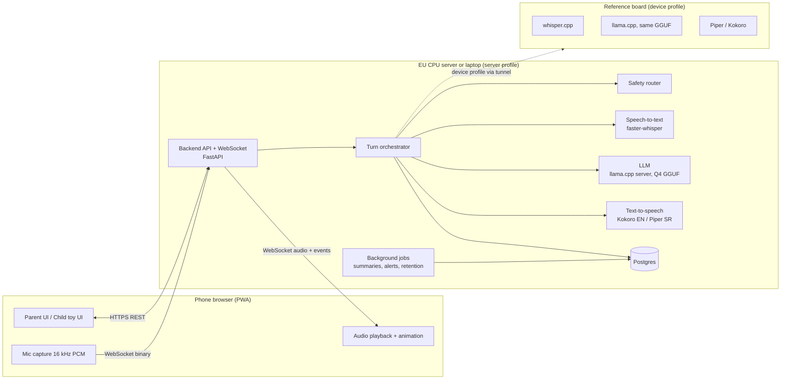
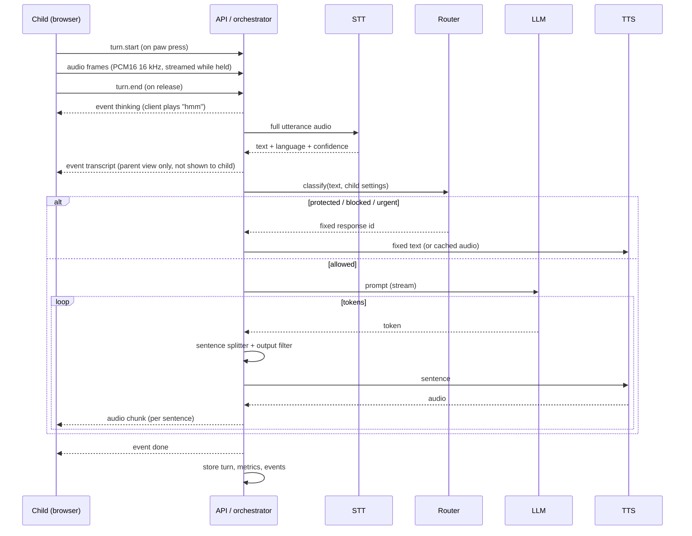

# Architecture

## 1. Overview



The phone only captures audio, plays audio and renders UI. Everything else runs on our
infrastructure in the EU. No external AI API is called.

## 2. Tech stack

| Layer | Choice | Why |
|---|---|---|
| Frontend | Next.js (React, TypeScript), Tailwind CSS, PWA manifest + service worker | mobile-first, fast to build, installable |
| Animation | Rive (preferred) or Lottie | state machines for character states, small files |
| Audio in browser | Web Audio API: AudioWorklet for capture, AudioContext for playback | low latency, works on iOS Safari after a user gesture |
| Backend | Python 3.12, FastAPI, Uvicorn, WebSockets | same language as ML tooling |
| Database | PostgreSQL 16, SQLAlchemy 2 + Alembic migrations | relational, EU-hosted |
| Jobs | APScheduler or Arq (Redis) | summaries at session end, retention deletes, alert emails |
| Auth | own implementation: Argon2id, JWT access token (15 min) + refresh token (httpOnly cookie, 30 days), TOTP for admin | no third-party auth provider holding child-related data |
| Email | EU SMTP provider (configurable) | verification, reset, alerts |
| STT | faster-whisper on CPU, int8 (server); whisper.cpp (device) | multilingual Whisper, Serbian supported |
| LLM runtime | llama.cpp `llama-server` (OpenAI-compatible API) with Q4_K_M GGUF | identical model files on server and device |
| TTS | Kokoro-82M for English (Apache 2.0); Piper-class voice for Serbian (license to be confirmed) | small, fast, runs on CPU on the device |
| Deployment | Docker Compose; Caddy as reverse proxy with automatic TLS | one machine for MVP |
| Device tunnel | Cloudflare Tunnel with a service token | reach the reference board without opening ports |
| Metrics | rows in Postgres (`turn_metrics`) + admin dashboard; optional Prometheus/Grafana later | metrics stay inside our infrastructure |

## 3. Repository structure

```
repo/
├─ docs/                      # this specification
├─ apps/
│  └─ web/                    # Next.js app (parent, child, admin)
│     ├─ app/(parent)/...
│     ├─ app/(child)/...
│     ├─ app/admin/...
│     ├─ lib/audio/           # capture worklet, resampler, player, RMS for mouth
│     └─ public/characters/   # Rive files, avatars, fallback audio
├─ services/
│  ├─ api/                    # FastAPI: auth, REST, WebSocket, orchestrator
│  │  ├─ orchestrator/        # turn pipeline, prompt builder, sentence splitter
│  │  ├─ safety/              # router, output filter, fixed responses loader
│  │  ├─ activities/          # lesson engine, story engine, intent detection
│  │  ├─ memory/              # summaries, bookmarks
│  │  ├─ inference/           # STT, LLM, TTS clients behind interfaces; profiles
│  │  └─ jobs/
│  ├─ inference/              # docker images: llama-server, faster-whisper, tts
│  └─ eval/                   # evaluation runner and test sets
├─ prompts/                   # system prompts (versioned), fixed responses
├─ content/                   # lessons, stories, word lists, characters (JSON)
├─ models/                    # model registry (YAML); weights are NOT in git
├─ infra/                     # docker-compose, Caddyfile, tunnel config, backups
└─ device/                    # setup scripts and compose file for the reference board
```

## 4. Inference profiles

| Profile | Where | Used for | Hardware |
|---|---|---|---|
| `server` | low-cost CPU host (no GPU) | the app: development, demo, small pilot | see 4.1 |
| `device` | reference board on our desk (+ one mid-range Android phone for the companion scenario) | realistic latency and memory numbers; live demos | toy-class SBC with RK3576 or RK3588S and 4–8 GB RAM, or Raspberry Pi 5; buy after checking current prices |

### 4.1 Hosting options for the `server` profile (no GPU, D7)

| Option | Cost | Capacity | Use |
|---|---|---|---|
| Developer laptop + Cloudflare Tunnel | €0 | 1 child | development, live demos; only up while the laptop is on |
| Oracle Cloud Always Free, Ampere A1 ARM (2 OCPU, 12 GB RAM since June 2026; [InfoQ](https://infoq.com/news/2026/07/oracle-cloud-free-tier-limits/)) | €0 | 1 child, smaller model | always-on demo link; capacity in some regions is limited |
| Hetzner Cloud ARM, e.g. CAX31 (8 vCPU Ampere, 16 GB) ([Spare Cores](https://sparecores.com/server/hcloud/cax31)) | about €25–30/month (verify current price and availability) | 1–2 children | always-on demo and small pilot |
| Reference board via tunnel (same as `device`) | one-time hardware cost | 1 child | demo on realistic hardware |
| Modal (pay-per-second GPU, about $30/month free credits; [CostBench](https://costbench.com/software/cloud-infrastructure/modal-labs/free-plan/)) | €0 within credits | bursts | evaluation runs only; cold starts make it unsuitable for live demos |
| Cloud startup credits (AWS, Google Cloud, Microsoft) | credits | any | apply once a company or accelerator can sponsor |

Default: laptop for development, one always-on ARM host (Oracle free or Hetzner) for the shared demo link.
A GPU server (e.g. Hetzner GEX44, RTX 4000 Ada 20 GB, €184/month + €159 setup; [Hetzner](https://www.hetzner.com/dedicated-rootserver/gex44/)) is considered only if the pilot needs more than 2 concurrent children.

Rules:
- Both profiles use the **same model files** (same GGUF, same quantization), the same prompts and the same context limit (2,048).
- The backend selects the profile per request from: admin override → account setting (demo accounts) → environment default.
- The `device` profile serves one child at a time. If unreachable within 3 s, fall back to `server` and log `profile_fallback`.
- Model and hardware decisions use `device` measurements only ([EVALUATION.md](EVALUATION.md)).

## 5. Turn pipeline



### 5.1 Steps and rules

1. **Start:** `turn.start` creates a `turn_id`; server checks session, limits and allowed hours. If not allowed → fixed line (sleep / limit).
2. **Audio upload:** client streams 20 ms frames during the press. Hard cap 15 s.
3. **STT:** run on release. Language forced to the child's setting. If `no_speech` or confidence below threshold → fixed line `not_heard`.
4. **Router** ([SAFETY.md](SAFETY.md#4-router)): returns one of `allow`, `fixed:<id>`, `blocked_by_parent`, `urgent:<id>`, `intent:<activity>`.
5. **Activity step:** if an activity is active or started, the activity engine updates state and produces the `ACTIVITY` block (and decides correctness for lessons).
6. **Prompt assembly** ([DATA_MODEL.md](DATA_MODEL.md#5-prompt-assembly)), then LLM call with `stream: true`, `max_tokens: 150` (250 for story parts), `temperature: 0.7`, `top_p: 0.9`, `cache_prompt: true`.
7. **Sentence splitter:** emit at `.`, `!`, `?` followed by space/end, or at 25 words. Each sentence goes through the **output filter** before TTS. A failed sentence aborts generation and plays fixed `fallback_safe`.
8. **TTS:** per sentence, returns PCM16 WAV; sent to the client as binary frames tagged with `turn_id` and sequence number.
9. **Done:** store turn, router decision, activity state, metrics; enqueue alert if needed.
10. **Barge-in:** a new `turn.start` while speaking cancels the LLM stream (close HTTP stream / `abort`), drops pending TTS, client stops playback immediately.

### 5.2 Latency budget (server profile on CPU, p50; to be replaced by measurements)

| Step | Budget |
|---|---|
| Upload remaining audio after release | 100 ms |
| STT (≤ 15 s audio, Whisper base int8) | 800 ms |
| Router + prompt assembly | 50 ms |
| LLM: prefill of new tokens (cached prefix) + first sentence | 2,000 ms |
| TTS first sentence (CPU) | 400 ms |
| Network + playback start | 250 ms |
| **Total to first audio** | **≈ 3.6 s** (NFR-02: ≤ 4 s) |

Levers if too slow: smaller model (Gemma 3 1B or Qwen3-0.6B), Whisper `base` instead of `small`, shorter first sentence, keeping the prompt cache warm.

## 6. Components in detail

### 6.1 Browser audio
- On paw press: `AudioContext.resume()` (required on iOS), start AudioWorklet capture, downsample to 16 kHz mono PCM16, send binary frames.
- Show input level ring from RMS.
- Playback: queue of sentence WAV buffers in order of sequence number; mouth animation from output RMS.
- Bundled offline fallback audio files for: `fallback`, `not_heard`, `hold_paw` (per language and character).
- Never use the browser's built-in Web Speech API (it sends audio to third-party servers).

### 6.2 Speech-to-text
- Interface: `transcribe(audio_pcm16, language) -> {text, confidence, no_speech_prob, duration_ms}`.
- Server: faster-whisper `base` on CPU with int8 (try `small` if accuracy is poor and latency allows), `beam_size=1`, VAD filter on, language forced.
- Device: whisper.cpp with the same model size, quantized.
- Audio is held in memory only and discarded after transcription (never written to disk or database).

### 6.3 LLM
- Interface: `generate_stream(messages, params) -> async iterator of tokens` (OpenAI-compatible `/v1/chat/completions`).
- `llama-server` flags (server, CPU): `-c 4096 --parallel 2` (2 slots × 2,048 tokens), `-ngl 0`, `-t <physical cores>`, `--jinja`. Device: `-c 2048 --parallel 1`, CPU/NPU per board.
- Requests beyond the free slots wait in a FIFO queue (max wait 10 s, then fallback line).
- Qwen3 family: thinking disabled (`chat_template_kwargs: {"enable_thinking": false}`); strip any `<think>` text defensively.
- Active model and its endpoint come from the model registry (`models/registry.yaml`, mirrored in the `models` table).

### 6.4 Text-to-speech
- Interface: `synthesize(text, language, voice_id) -> PCM16 WAV`.
- English: Kokoro-82M. Serbian: Piper-class VITS voice; **license must permit commercial demos** before showing to buyers. Until then Serbian TTS is internal-only.
- Normalize text before TTS: numbers to words, remove emojis and markdown.
- Cache audio for all fixed responses and greetings at startup (per character and language).

### 6.5 Router, filter, activities, memory
See [SAFETY.md](SAFETY.md), [CONTENT.md](CONTENT.md), [DATA_MODEL.md](DATA_MODEL.md).

## 7. APIs

### 7.1 REST (JSON, `/api/v1`)

| Method | Path | Purpose |
|---|---|---|
| POST | `/auth/register` | create parent (email, password, consent_version, adult_confirmed) |
| POST | `/auth/verify` | verify email token |
| POST | `/auth/login` / `/auth/refresh` / `/auth/logout` | session |
| POST | `/auth/password-reset/request` / `/confirm` | reset |
| POST | `/auth/pin` / `/auth/pin/verify` | set / verify parent PIN |
| GET/POST/PATCH/DELETE | `/children`, `/children/{id}` | child profiles |
| GET/PUT | `/children/{id}/settings` | topics, limits, memory, transcripts, alerts |
| POST | `/child-mode/enter` | returns a child-mode token bound to device + parent session |
| POST | `/child-mode/select` | choose child; returns child session token |
| POST | `/child-mode/exit` | requires PIN |
| GET | `/children/{id}/sessions` | list with summaries |
| GET | `/sessions/{id}/turns` | transcript (403 if transcripts off, except urgent turns) |
| GET/PATCH/DELETE | `/children/{id}/memory`, `/memory/{item_id}` | bookmarks and facts |
| GET/PATCH | `/alerts`, `/alerts/{id}` | list, mark seen |
| GET | `/account/export` | JSON export |
| DELETE | `/account`, `/children/{id}` | deletion |
| (admin) | `/admin/models`, `/admin/prompts`, `/admin/eval-runs`, `/admin/metrics`, `/admin/ratings`, `/admin/profiles` | admin features |

### 7.2 WebSocket `/ws/turns` (child session token required)

Client → server:

| Message | Payload |
|---|---|
| `turn.start` | `{type, turn_id_client, activity_hint?}` |
| binary frame | PCM16 16 kHz mono, 20 ms per frame, prefixed with 4-byte sequence number |
| `turn.end` | `{type, turn_id_client}` |
| `turn.cancel` | `{type}` (barge-in or leaving screen) |
| `activity.select` | `{type, activity: "why"|"story"|"numbers"|"english"}` (card tap) |
| `choice.select` | `{type, choice_index}` (story picture tap) |

Server → client:

| Message | Payload |
|---|---|
| `state` | `{type, state: "listening"|"thinking"|"speaking"|"idle"|"sleeping"}` |
| `visual` | `{type, kind: "exercise"|"word_card"|"story_choices", data}` |
| binary frame | WAV chunk: header `{turn_id, seq}` + audio |
| `turn.done` | `{type, turn_id}` |
| `limit` | `{type, minutes_left}` |
| `error` | `{type, code}` (client plays local fallback audio; never shows text to the child) |

The transcript and model text are **not** sent to the child client.

## 8. Configuration

Environment variables (examples): `DATABASE_URL`, `JWT_SECRET`, `SMTP_*`, `INFERENCE_PROFILE_DEFAULT=server`,
`LLM_SERVER_URL`, `STT_SERVER_URL`, `TTS_SERVER_URL`, `DEVICE_TUNNEL_URL`, `DEVICE_TUNNEL_TOKEN`,
`ENVIRONMENT=demo|pilot|eval`, `TRANSCRIPT_RETENTION_DAYS=30`.
Model registry: `models/registry.yaml` (id, family, file, quant, size_mb, context, runtime, endpoints per profile, license).

## 9. Security

- TLS everywhere (Caddy). HSTS. CSP without third-party scripts.
- Child-mode token: scoped to one parent account and one device, can only call `/ws/turns` and `/child-mode/*`.
- Rate limits: auth 10/min/IP; turns 20/min per child.
- Admin endpoints on a separate subdomain or IP allow-list + TOTP.
- Database encrypted at rest (disk encryption), daily encrypted backups kept 7 days.
- No raw audio persisted anywhere; logs never contain transcript text (only IDs).
- Dependency scanning in CI; secrets only in environment.

## 10. Deployment

- `infra/docker-compose.yml`: `web`, `api`, `jobs`, `postgres`, `redis`, `llm` (llama-server), `stt`, `tts`, `caddy`. Images must build for both `arm64` and `amd64` (ARM hosts and laptops).
- Memory budget on a 12–16 GB host: LLM ≤ 2 GB, STT ≤ 0.5 GB, TTS ≤ 0.3 GB, Postgres + app ≤ 1.5 GB.
- Model weights downloaded by a setup script from Hugging Face into a volume (checksums in the registry).
- Environments: `demo` (seeded data), `pilot` (real families, after checklist), `eval` (runner only).
- `device/`: compose file for arm64 (`llm`, `stt`, `tts`) + Cloudflare Tunnel; a `bench` script for [EVALUATION.md](EVALUATION.md#5-device-benchmarks).
