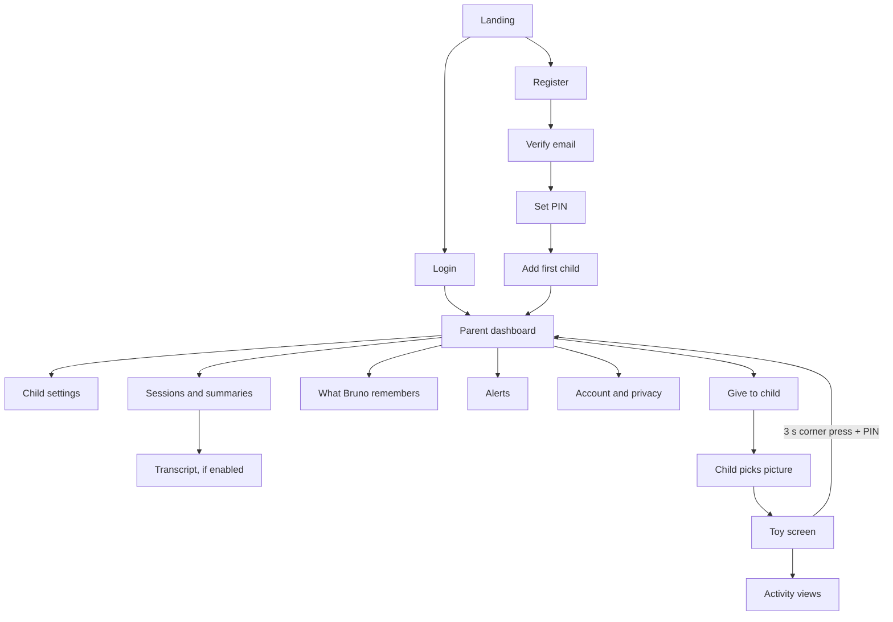

# UI and flows

Mobile first (360–430 px wide portrait). Two different design languages:
**parent** = calm, standard mobile app; **child** = full-screen toy, no reading needed.

## 1. Navigation map



Admin pages live under `/admin` with a separate layout; never linked from parent pages.

## 2. Parent screens

| Screen | Content | Notes |
|---|---|---|
| Landing | Short explanation, "Create account", "Log in", link to privacy summary | No child imagery that implies a real product launch |
| Register | Email, password, 18+ checkbox, consent checkbox with expandable privacy summary | Consent not pre-ticked |
| Set PIN | 4-digit PIN twice | Explain: "You need this PIN to leave child mode" |
| Add child | Nickname, age picker, language, interest chips, avatar grid (12 pictures), character picker with voice sample | Wizard, 3 steps |
| Dashboard | Per-child card: minutes today / limit (progress ring), last session summary, topic tags, alert badge; big button "Give to child" | Cards swipe horizontally for several children |
| Child settings | Toggles, blocked topics (chips + input), limit slider, allowed hours, memory switch, transcripts switch, alerts switch | Each setting has one-line explanation |
| Sessions | List: date, duration, activity icons, 2–3 sentence summary | Tap → transcript if enabled, else summary only |
| Transcript | Chat-style bubbles; shield icon on fixed-response turns | Info banner: "Deleted automatically after 30 days" |
| What Bruno remembers | Grouped list: profile facts, bookmarks (story, numbers level, English words), last summary; edit/delete per item; "Forget everything" | Destructive actions confirmed |
| Alerts | List with category icon, time, child's sentence (urgent), guidance text | Mark as seen |
| Account and privacy | Change email/password/PIN, export data, delete child, delete account, privacy policy, consent version | |

## 3. Child screens

### 3.1 Picture picker
Grid of the family's child avatars (max 5), large (≥ 120 px). Tap → toy screen. No text required.

### 3.2 Toy screen (main)

```
┌─────────────────────────────┐
│ [hidden exit corner]        │
│                             │
│        ANIMATED             │
│        CHARACTER            │
│      (60% of height)        │
│                             │
│  ○ ○ ○ ○  activity cards    │
│  (Why) (Story) (123) (ABC)  │
│                             │
│        ( PAW BUTTON )       │
│         ≥ 96 px, bottom     │
└─────────────────────────────┘
```

- Paw: press and hold to talk; vibration (where supported) and a soft "pop" on press; release to send.
- Activity cards: icon only (question mark, open book, apples, ABC flag); disabled activities are hidden, not greyed out.
- Space bar works as the paw on desktop.

### 3.3 Character states

| State | Visual | Sound |
|---|---|---|
| Sleeping | eyes closed, "zzz" | none |
| Idle | slow breathing, blinking | none |
| Listening | ears up, leans forward, mic ring pulses with voice level | soft pop on start |
| Thinking | eyes look up, dots | short "hmm" at release |
| Speaking | mouth opens with audio amplitude | answer audio |
| Happy | jump, stars | on correct answers |
| Goodbye | yawn, waves | goodbye line |

Animations: Lottie or Rive files per character; mouth driven by audio RMS from the Web Audio API.

### 3.4 Activity views
- **Numbers:** exercise pictures (apples, stars, cars) appear above the character; correct answer → happy state.
- **English:** picture card of the word; after a correct answer, the English word is shown large.
- **Story:** two big picture choices appear when Bruno offers a choice (child can tap or say it).
- **Why:** no extra view.

### 3.5 Goodbye / locked
Sleeping character, moon, paw disabled. No text except a small lock icon for parents.

## 4. Child design rules

- No reading required; every action has an icon, sound or voice.
- Touch targets ≥ 64 px; paw ≥ 96 px.
- No scrolling, links, ads, notifications, external content, chat-style text log, or "infinite" content.
- Calm palette, no flashing; sounds at moderate volume.
- Never show model output as text to the child (voice only); the parent can read it.
- Session end is gentle and predictable (warning 2 minutes before).

## 5. Copy (examples, both languages)

| Key | Serbian | English |
|---|---|---|
| greet | Zdravo, {name}! Hoćeš da pričamo, da ti ispričam priču ili da se igramo? | Hi, {name}! Want to talk, hear a story or play a game? |
| hold_paw | Drži šapu dok pričaš, slušam te! | Hold my paw while you talk, I'm listening! |
| not_heard | Nisam te dobro čuo, možeš li još jednom? | I didn't quite hear you, can you say it again? |
| fallback | Hmm, malo sam se umorio. Probaj opet! | Hmm, I'm a bit sleepy. Try again! |
| limit_warning | Još malo pa idem na spavanje. | I'm going to sleep soon. |
| goodbye | Bilo mi je lepo! Ispričaj mami ili tati šta smo naučili. Laku noć! | That was fun! Tell mom or dad what we learned. Good night! |
| parents_can_see | Mama i tata mogu da vide o čemu pričamo. | Mom and dad can see what we talk about. |

The `parents_can_see` line is said once in the first session of each child (see [SAFETY.md](SAFETY.md#8-honesty-towards-the-child)).

## 6. Admin UI (desktop is fine)

Pages: Models, Prompts, Evaluation runs (list, new run, report), Metrics dashboard, Rating queue,
Device profile status, Audit log. Plain table-based UI; no design polish needed.
